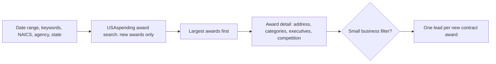

# Federal Contract Winner Leads from USAspending

[](https://apify.com/Turboextract/federal-contract-winners)
[](LICENSE)
[](#pricing)

**Find companies that just won US federal contracts, days after the award is signed.** Each lead includes the award amount, potential value, agency, what was bought, NAICS and PSC codes, the company's address, its small business status and, where reported, its top executives. Data comes straight from USAspending.gov, the official US government spending database.

A company that just won a federal contract has new money and new work to deliver. It needs subcontractors, staff, equipment, software, insurance and financing, often within weeks.

**Try it now →** [apify.com/Turboextract/federal-contract-winners](https://apify.com/Turboextract/federal-contract-winners)

---

## Why this exists

- A company that just won a federal contract has new money and new work to staff and supply.
- USAspending mixes new awards with years of modifications, so finding fresh winners takes work.
- Company address, small business status and executives sit on separate pages.
- Contracting intelligence platforms are priced per seat per year.

---

## Who this is for

- **Subcontractors and suppliers** looking for primes that need help delivering a new award
- **Staffing and recruiting agencies** placing cleared and technical talent with fresh contract winners
- **B2B sales teams** selling software, equipment and services to government contractors
- **Lenders and factoring companies** offering contract financing to small businesses
- **Capture and BD teams** tracking competitors and agency buying patterns

---

## What you get per lead

```json
{
  "company": "SOLIDUS LABS, INC",
  "uei": "TBB6NCR5KS63",
  "awardId": "9523ZY27C0001",
  "awardAmount": 2690004,
  "potentialValue": 23936446,
  "awardType": "DEFINITIVE CONTRACT",
  "description": "AUTOMATED DIGITAL ASSET MARKET SURVEILLANCE SYSTEM",
  "agency": "Commodity Futures Trading Commission",
  "dateSigned": "2026-11-05",
  "startDate": "2026-11-09",
  "endDate": "2027-11-08",
  "naics": "541511",
  "naicsDescription": "Custom Computer Programming Services",
  "psc": "7H20",
  "recipientAddress": { "street": "50 W 23RD ST STE 802", "city": "New York", "state": "NY", "zip": "10010", "country": "USA" },
  "isSmallBusiness": true,
  "businessCategories": ["Small Business", "U.S.-Owned Business", "Corporate Entity Not Tax Exempt"],
  "executives": [],
  "competition": "NOT COMPETED",
  "setAside": "NO SET ASIDE USED.",
  "offersReceived": 1,
  "awardUrl": "https://www.usaspending.gov/award/CONT_AWD_9523ZY27C0001_9507_-NONE-_-NONE-",
  "recipientUrl": "https://www.usaspending.gov/recipient/b0dc161f-0fe6-53c5-45f1-b277cd48c67d-C/latest"
}
```

`executives` lists the top paid officers when the company reports them to SAM.gov, for example five named officers on a recent NASA award to Johns Hopkins APL.

---

## How it works



The actor uses the official USAspending API. It searches only **new** contract awards (not modifications to old ones), then looks up each award for the company details. No scraping, no logins.

---

## Quick start

1. Click **Try for free**.
2. Keep **Awarded in the last N days** at `7`.
3. Add **Keywords** like `cybersecurity` or **NAICS codes** like `541512`.
4. Optional: tick **Small businesses only** or set **Company states**.
5. Click **Start** and export to CSV or your CRM.

Schedule it weekly to get every new winner in your niche.

### API

```bash
curl -X POST "https://api.apify.com/v2/acts/Turboextract~federal-contract-winners/run-sync-get-dataset-items?token=YOUR_TOKEN" \
  -H "Content-Type: application/json" \
  -d '{
    "daysBack": 7,
    "naicsCodes": ["541512", "541519"],
    "recipientStates": ["VA", "MD", "DC"],
    "minAmount": 250000,
    "maxResults": 200
  }'
```

### Python

```python
from apify_client import ApifyClient

client = ApifyClient("YOUR_TOKEN")
run = client.actor("Turboextract/federal-contract-winners").call(run_input={
    "daysBack": 14,
    "keywords": ["construction"],
    "smallBusinessOnly": True,
})
for w in client.dataset(run["defaultDatasetId"]).iterate_items():
    print(w["company"], w["awardAmount"], w["agency"], w["recipientAddress"]["city"])
```

---

## Input fields

| Field | Default | What it does |
|---|---|---|
| `daysBack` | 7 | New awards in the last N days |
| `dateFrom` / `dateTo` | – | Exact date range |
| `keywords` | – | Words to match in the award |
| `naicsCodes` | – | NAICS codes or prefixes |
| `agencies` | all | Exact top-level agency names |
| `recipientStates` | all | Company state codes |
| `minAmount` | 25000 | Minimum award amount in USD |
| `smallBusinessOnly` | false | Only registered small businesses |
| `includeDetails` | true | Address, executives, competition and set-aside details |
| `maxResults` | 100 | Cap per run, largest awards first |

---

## Pricing

**$0.005 per contract winner delivered.** 1,000 fresh leads cost $5.

| Option | 1,000 contract winner leads |
|---|---|
| **Federal Contract Winner Leads** | **$5**, address and executives included |
| Other USAspending actors on Apify | $1 to $25; lead-focused ones $15 to $25 |
| Government contracting intelligence platforms | Annual subscriptions per seat |
| Searching USAspending by hand | Hours per week |

---

## Common use cases

- **Subcontracting outreach**: small IT firms in Virginia that won $250k+ this week
- **Staffing**: defense contractors with new awards that need cleared engineers
- **Contract financing**: small businesses with new awards and few prior contracts
- **Competitive intel**: who your target agency is buying from, and at what price
- **Insurance and bonding**: new contractors that need coverage for fresh awards

---

## Tips for best results

- Use 7 or more days, since agencies report awards a few days after signing.
- Filter by NAICS prefix (for example `5415` for IT services) rather than long keyword lists.
- Combine `smallBusinessOnly` with `recipientStates` for local subcontracting outreach.
- Turn off `includeDetails` for fast, large market scans.

---

## Pairs well with

- [Newly Funded Startup Leads](https://apify.com/Turboextract/startup-funding-leads): companies that just raised private money
- [EU Public Tender Alerts](https://apify.com/Turboextract/eu-tender-alerts): open public tenders across Europe
- [Global Sanctions Screening](https://apify.com/Turboextract/global-sanctions-screening): screen partners before teaming

---

## FAQ

**How fresh is the data?** Agencies report contract awards to FPDS within a few days of signing, and USAspending updates daily. Use 7 days or more for complete results.

**Does it include emails?** USAspending has names, address and executives, not emails. Chain with B2B Lead Enrichment Pipeline to add website contacts.

**Why are executives empty for some companies?** Companies only report their top paid officers to SAM.gov in certain cases. When they do, you get them.

**Does it include grants?** No, contracts only (definitive contracts, purchase orders, delivery and task orders, BPA calls).

**Is this legal to use?** USAspending.gov data is public US government information.

---

## SEO keywords

federal contract award leads, government contract winners list, USAspending API, new federal contracts, GovCon leads, FPDS contract awards, subcontracting opportunities, government contractor database, SAM.gov alternative, B2G sales leads

---

## Support

- Actor page: https://apify.com/Turboextract/federal-contract-winners
- Issues and questions: open an issue in this repo
- Community Discord: https://discord.gg/8SrXSCpvgj

Built and maintained by [Turboextract](https://apify.com/Turboextract) on the Apify platform.

---

## License

The documentation and examples in this repository are MIT licensed. The actor itself runs on the Apify platform.
